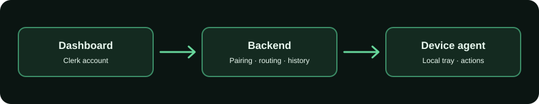

# Vortix

Vortix lets you inspect and control your own computer from a browser. A Windows tray agent connects to a hosted WebSocket backend; a Next.js dashboard provides voice and text commands, screen-aware workflows, file transfer, and read-only storage scans. Account sign-in uses Clerk. AI planning and transcription use Groq on the backend.

## Try it on Windows

1. Install [Node.js](https://nodejs.org/en/download) and download [Vortix 1.2.13 for Windows](https://vortixai.vercel.app/downloads/VortixSetup-1.2.13.exe). Verify the [SHA256 checksum](https://vortixai.vercel.app/downloads/VortixSetup-1.2.13.exe.sha256) if desired.
2. Sign in at [vortixai.vercel.app](https://vortixai.vercel.app). In the dashboard, choose **Add device → Create code**.
3. In the tray app, set a device password and choose **Enter pairing code**. Paste the code within ten minutes. The device appears in your dashboard after it connects.

Existing owned devices registered before pairing codes continue to reconnect with their saved password. For an older unclaimed device, create a code and run `vortix pair` to give it a new random identity. The name-and-password path remains available for legacy recovery.

The Windows download and `cli_vortix` package are built from the same `agent/` source. The npm registry may have an older release; the Windows download above is the matching version for this repository.

## What it does

- **Voice and text control:** speak or type a request. Windows interactive tasks use a bounded screenshot → action → verification loop after you approve the goal. Direct shell commands are also available.
- **Storage Rescue:** scan accessible drives for large files and folders without deleting them. Opt into daily read-only Rescue Autopilot scans of your user folders to compare growth over time. Scans are bounded and may be partial.
- **Screen sharing and file transfer:** view a connected desktop and move files through the dashboard.
- **Discord messaging:** preview the exact recipient and text, then let the workflow verify the visible conversation and draft before sending.
- **History:** device ownership and command outcomes persist when the backend has PostgreSQL.

## Run locally

Use Node.js 22.12+ and one Clerk application for the backend and dashboard.

| Terminal | Steps |
| --- | --- |
| Backend | `cd backend`, `npm ci`, copy `.env.example` to `.env`, set Clerk credentials, `npm start` |
| Dashboard | `cd dashboard`, `npm ci`, copy `.env.example` to `.env.local`, set the matching Clerk credentials and `NEXT_PUBLIC_BACKEND_WS=ws://localhost:8080`, `npm run dev` |
| Agent | `cd agent`, `npm ci`, `node agent.js login`, set `BACKEND_URL=ws://localhost:8080`, `node agent.js pair`, `node agent.js start` |

Create the pairing code from the signed-in local dashboard and paste it at the agent prompt. On PowerShell, set the agent URL with `$env:BACKEND_URL='ws://localhost:8080'` in the agent terminal. The backend needs `GROQ_API_KEY` for hosted AI features. Production should use `DATABASE_URL` for durable ownership, pairing, attempt counters, and history. File storage is for a single local process.

To build the Windows installer, run `npm ci`, `npm run build:tray`, and `npm run build:installer` inside `cli_vortix/`. `npm pack` copies the maintained agent files into the package at build time.

## Verify

Run `npm test` in `backend/` and `agent/`, and `npm run lint && npm run build` in `dashboard/`. GitHub Actions runs these on pushes and pull requests, checks production dependencies with `npm audit`, tests PostgreSQL with an isolated database, and builds the Windows installer.

The [security benchmark](benchmarks/RESULTS.md) replays unknown-device registration and password-guess probes against commit `048f7c0` and this version.

## Security and limits

New agents require a one-time dashboard pairing code. The backend binds them to the signed-in account, stores salted password hashes, and limits failed password attempts by device and network address. Use `wss://` for hosted connections. The tray can pause or quit the agent locally. See [SECURITY.md](SECURITY.md) for the trust boundary and reporting guidance.

Vortix is a remote execution tool. A compromised backend or owner account could send commands to an online agent; screenshot-based checks can also misread an app. Do not run the agent with administrator rights, and keep it paused when remote control is not needed. No remote-control app can guarantee 100% security.

Pending plans and live workflow state are currently held in backend memory and stop on a restart. The UI is not yet covered by component tests. See [ROADMAP.md](ROADMAP.md) for planned work and measured benchmarks.

## Repository

| Path | Purpose |
| --- | --- |
| `agent/` | Maintained device agent and tests |
| `backend/` | Active server, persistence, AI orchestration, and tests |
| `dashboard/` | Next.js web app |
| `cli_vortix/` | CLI, Windows tray, and installer build |

Only people who explicitly agree to be named are listed as testers or endorsers. A public GitHub profile is not evidence that its owner reviewed or trusts Vortix.
